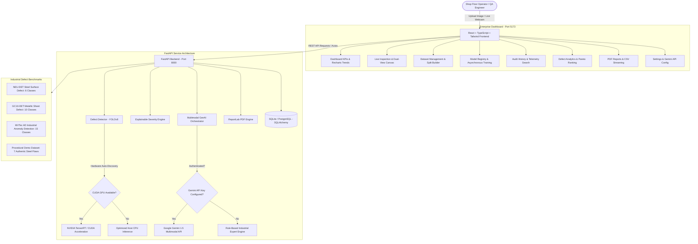

# IndusVision — Multimodal AI-Based Industrial Quality Inspection and Defect Explanation System

[](https://fastapi.tiangolo.com)
[](https://react.dev)
[](https://www.typescriptlang.org)
[](https://tailwindcss.com)
[](https://ultralytics.com)
[](https://ai.google.dev)
[](#)

A complete, working, end-to-end Final-Year B.Tech project combining **computer vision (Ultralytics YOLOv8)** and **multimodal generative AI (Google Gemini VLM)** to detect, localize, evaluate, and explain manufacturing defects in steel and metallic components.

---

## 📌 1. Project Overview

### Problem Statement
Modern manufacturing plants (steel rolling mills, automotive stamping, electronics manufacturing) rely heavily on automated visual quality inspection. While conventional computer vision systems can draw bounding boxes around flaws, they fail to answer crucial engineering questions:
- *What physical characteristics define the flaw?*
- *What root mechanical or thermal parameters likely caused the failure?*
- *What is the structural severity level?*
- *What immediate corrective actions must the operator take on the line?*

### Proposed Solution
This system creates a hybrid multimodal inspection architecture:
1. **Ultralytics YOLOv8** handles low-latency, millisecond-precision optical defect detection and localization.
2. **Explainable Severity Assessment Engine** uses transparent mathematical rules to categorize risk into `LOW`, `MEDIUM`, `HIGH`, or `CRITICAL` and assigns an actionable disposition (`PASS`, `FAIL`, or `MANUAL_REVIEW`).
3. **Multimodal Generative AI (Google Gemini VLM)** analyzes visual defect imagery alongside detection coordinates to produce ISO 9001-compliant structured defect explanations and shop-floor corrective actions.
4. **ReportLab Engine** compiles inspection imagery, defect telemetry, and AI advice into downloadable formal PDF audit reports.

---

## 🏛️ 2. System Architecture



---

## 🛠️ 3. Technologies Used

### Frontend
- **React 18/19 & TypeScript:** Strongly typed modular component hierarchy.
- **Vite:** High-speed modern development and production bundler.
- **Tailwind CSS:** Custom industrial enterprise color tokens (Navy `#0B132B`, Slate `#F8FAFC`, Blue `#2563EB`).
- **Lucide React:** High-contrast industrial UI icons.
- **Recharts:** Responsive AreaCharts, BarCharts, and Donut charts.
- **Axios:** REST API integration with timeout and error handling.

### Backend
- **Python 3.11+ / 3.12:** Asynchronous core runtime.
- **FastAPI & Uvicorn:** Async REST API framework with automatic OpenAPI Swagger documentation.
- **SQLAlchemy 2.0:** Relational ORM supporting SQLite and PostgreSQL.
- **Ultralytics YOLOv8:** Object detection and bounding box regression.
- **Google Gemini API:** Vision-language model for multimodal interpretation.
- **OpenCV & Pillow:** Image filtering, grain synthesis, and bounding box drawing.
- **ReportLab:** Vector-grade PDF generation with tables and embedded imagery.
- **Pytest:** Comprehensive automated backend test suite.

---

## 📂 4. Project Directory Structure

```
industrial-quality-inspector/
├── frontend/
│   ├── src/
│   │   ├── components/        # SeverityBadge, DecisionBadge, MetricCard, Modals
│   │   ├── layouts/           # Sidebar, MainLayout
│   │   ├── pages/             # 8 complete application pages
│   │   ├── services/          # Typed Axios REST API client
│   │   ├── types/             # TypeScript domain definitions
│   │   ├── App.tsx            # Navigation and layout router
│   │   ├── main.tsx           # React DOM root entry
│   │   └── index.css          # Custom scrollbars and Tailwind styles
│   ├── index.html             # Google Fonts Inter and SVG favicon
│   ├── package.json           # Frontend dependencies
│   ├── vite.config.ts         # Vite bundler configuration
│   └── tailwind.config.js     # Enterprise theme configuration
│
├── backend/
│   ├── app/
│   │   ├── api/               # Modular REST endpoints (health, dashboard, inspection, etc.)
│   │   ├── core/              # Config, logging, settings
│   │   ├── database/          # Connection, schema models, auto-seeder
│   │   ├── models/            # SQLAlchemy database tables
│   │   ├── schemas/           # Pydantic request/response schemas
│   │   ├── ml/                # YOLO detector, severity engine, evaluator
│   │   ├── genai/             # Gemini provider, response validator, rule fallback
│   │   ├── datasets/          # NEU-DET, GC10-DET, MVTec AD managers
│   │   ├── reports/           # ReportLab PDF report compiler
│   │   └── main.py            # FastAPI ASGI entrypoint
│   ├── scripts/               # Training, dataset preparation, demo generation
│   ├── tests/                 # Automated pytest test suite
│   ├── uploads/               # Stored inspection images
│   ├── datasets/              # Benchmark directories and demo samples
│   ├── weights/               # YOLO model weights (.pt)
│   ├── reports/               # Generated PDF audit reports
│   └── requirements.txt       # Python dependencies
│
├── docs/                      # Six-day development and demonstration guide
├── .gitignore
└── README.md
```

---

## ⚡ 5. Step-by-Step Setup & Independent Terminal Execution

### Terminal 1: Backend Setup (Windows PowerShell)

```powershell
# Navigate to backend directory
cd "e:\Gen Ai Major Project\industrial-quality-inspector\backend"

# Optional: Create virtual environment
python -m venv .venv
.venv\Scripts\Activate.ps1

# Install requirements
python -m pip install -r requirements.txt

# Start backend server
python -m uvicorn app.main:app --reload --port 8000
```

- **Backend API:** `http://localhost:8000`
- **Swagger Documentation:** `http://localhost:8000/docs`
- **Health Check:** `http://localhost:8000/api/health`

### Terminal 2: Frontend Setup (Separate PowerShell Window)

```powershell
# Navigate to frontend directory
cd "e:\Gen Ai Major Project\industrial-quality-inspector\frontend"

# Install NPM dependencies
npm install

# Start Vite development server
npm run dev
```

- **Frontend Application:** `http://localhost:5173`

---

## 🧪 6. Automated Testing & Verification

Run backend unit and integration tests:

```powershell
cd "e:\Gen Ai Major Project\industrial-quality-inspector\backend"
python -m pytest tests/ -v
```

**Test Coverage:**
- `test_health.py`: Verifies `/api/health` and database connectivity.
- `test_severity.py`: Tests severity scoring (LOW, MEDIUM, HIGH, CRITICAL, PASS/FAIL).
- `test_genai.py`: Validates JSON schema parsing and rule-based domain fallback.
- `test_reports.py`: Tests ReportLab PDF compilation and file structure.
- `test_inspection.py`: Tests end-to-end sample inspection and catalog retrieval.

Test frontend production bundle:

```powershell
cd "e:\Gen Ai Major Project\industrial-quality-inspector\frontend"
npm run build
```

---

## 📊 7. Supported Industrial Datasets

| Dataset | Defects / Categories | Original Format | Conversion Target |
| :--- | :--- | :--- | :--- |
| **NEU-DET** | 6 classes (Crazing, Inclusion, Patches, Pitted Surface, Rolled-in Scale, Scratches) | Pascal VOC XML | YOLO Normalized Bounding Boxes |
| **GC10-DET** | 10 classes (Punching hole, Welding line, Crescent gap, Water spot, Oil spot, Silk spot, Inclusion, Rolled-in scale, Scratches, Waist folding) | Pascal VOC XML | YOLO Normalized Bounding Boxes |
| **MVTec AD** | 15 categories (metal_nut, screw, tile, etc.) | PNG Masks | Pixel-level Ground-Truth Anomaly Evaluation |
| **Demo Dataset** | 7 realistic steel plate flaw images | JPG / OpenCV | Instant One-Click Out-of-the-Box Demo |

---

## 🤖 8. Multimodal GenAI Integration & Fallback

The system calls the **Google Gemini API** (`gemini-1.5-flash` or `gemini-1.5-pro`) using structured JSON schema output:

```json
{
  "defect_name": "Surface Scratches",
  "description": "Continuous longitudinal surface abrasion grooves aligned parallel to the rolling pass direction.",
  "location": "Upper-right region",
  "severity": "HIGH",
  "possible_causes": [
    "Mechanical rubbing against worn guide plates or pinch rollers",
    "Metal slivers or foreign debris lodged in bridle roller"
  ],
  "recommended_actions": [
    "Inspect conveyor rollers and side guides for burrs or seized bearings",
    "Polish contact surfaces with 400-grit dressing stone"
  ],
  "inspection_decision": "MANUAL_REVIEW",
  "quality_summary": "High-severity surface scratches detected. Part rerouted for manual review."
}
```

### Safety & Operational Integrity
- **No Hallucinations:** The LLM does *not* invent coordinates or confidence; it receives detection outputs from YOLO.
- **Rule-Based Metallurgical Fallback:** If the Gemini API key is missing, an integrated knowledge base provides instant, authentic explanations without cloud dependencies.

---

## 📄 9. Database Architecture

The SQLite database (`app.db`) is generated automatically at backend startup with 7 normalized tables:
- `inspections`: Primary inspection logs, timestamps, overall disposition, and AI explanations.
- `detected_defects`: Individual bounding boxes `[x1, y1, x2, y2]`, confidence scores, and defect areas.
- `datasets`: Catalog of local benchmarks, image counts, and split paths.
- `trained_models`: Model checkpoints, architecture types, and validation metrics (mAP, Precision, Recall).
- `training_jobs`: Asynchronous fine-tuning jobs with progress tracking and loss convergence logs.
- `generated_reports`: Stored PDF reports with file sizes and download URLs.
- `application_settings`: System parameters, confidence thresholds, and Gemini API keys.

---

## 🔒 10. Known Limitations & Future Scope

### Known Limitations
- **Single-Angle Perspective:** Optical inspection relies on 2D surface imagery; subsurface internal flaws require complementary radiographic or ultrasonic testing.
- **Gemini Rate Limits:** High-throughput production lines (> 60 parts/min) should deploy local open-weight vision models (e.g. LLaVA or Florence-2) to avoid cloud rate limits.

### Future Enhancements
- Integration with robotic pick-and-place actuators via OPC-UA / MQTT industrial protocols.
- 3D laser profilometry point-cloud integration for depth defect measurement.
- Real-time continuous active learning loop from operator overrides.
# Indus-Vision

